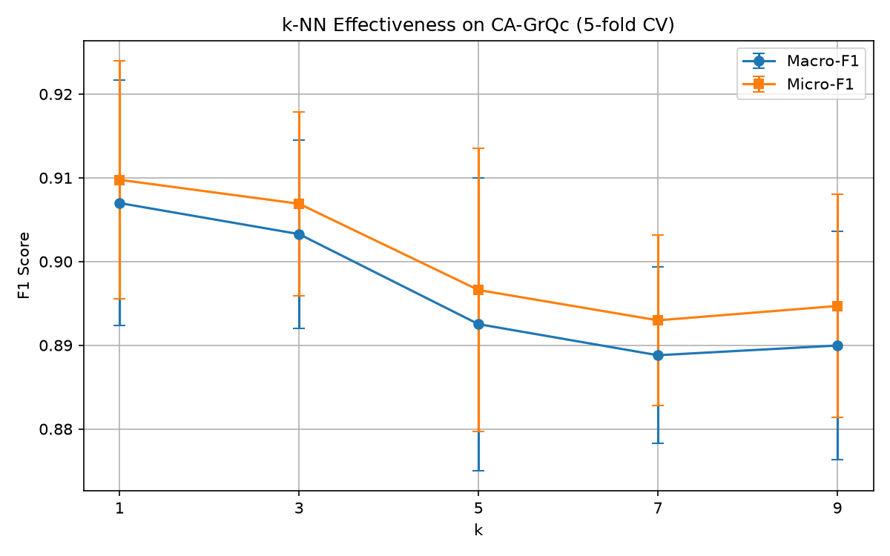
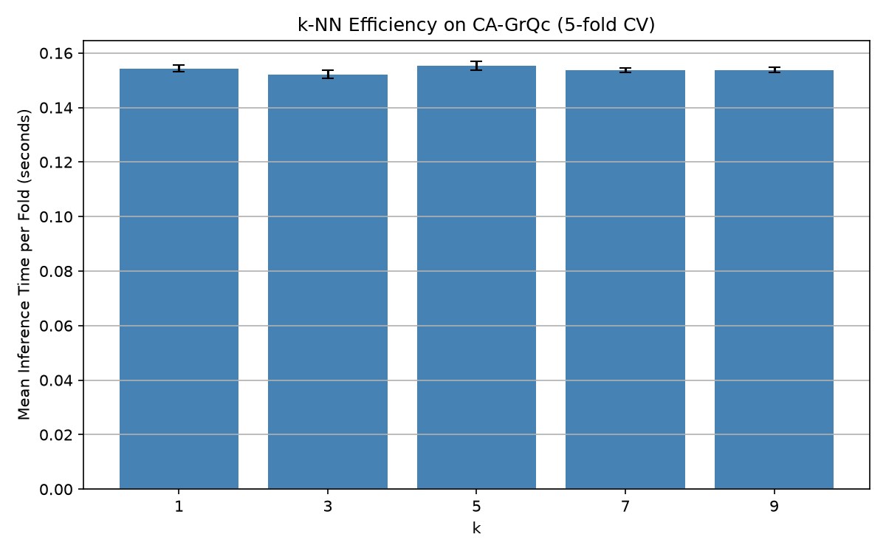

<div align="center">

# 📊 k-NN Graph Classifier

**Machine learning classification on real-world collaboration networks using k-Nearest Neighbors**

[](https://python.org)
[](https://networkx.org)
[](https://numpy.org)
[](LICENSE)

</div>

---

## 📋 Overview

A complete **k-Nearest Neighbors classification pipeline** that operates on real-world graph data. The project extracts structural features from collaboration networks and uses them to classify a transparent synthetic target: whether a node's degree is above the graph median. The classifier and evaluation metrics are implemented **from scratch** without scikit-learn.

### Datasets
| Dataset | Nodes | Unique undirected edges | Availability |
|---------|-------|-------------------------|--------------|
| CA-GrQc | 5,242 | 14,496 | Included in `data/` |
| com-DBLP | 317,080 | 1,049,866 | Optional; download separately from SNAP |

The included CA-GrQc edge list contains 28,980 directed rows. Loading it as an
undirected collaboration graph collapses reciprocal pairs to 14,496 unique
edges, matching the graph that the classifier evaluates.

---

## ✨ Features

- 🧠 **k-NN from scratch** — No scikit-learn; core algorithm hand-implemented
- 📐 **Leakage-aware graph features** — Clustering coefficient and average neighbor degree; the label-defining node degree is never an input feature
- 📊 **Stratified cross-validation** — Reproducible five-fold evaluation for k = 1, 3, 5, 7, 9
- 📈 **Evaluation metrics** — Mean Macro-F1 and Micro-F1 with fold-to-fold variability
- ⏱️ **Efficiency benchmarks** — Mean inference time per fold with variability
- 📉 **Scalability testing** — Linear-time BFS sampling and a low-cost, non-label feature for the optional large dataset
- ✅ **Regression tests and CI** — Offline unit coverage on Python 3.10 and 3.12
- 📊 **Auto-generated plots** — Effectiveness, efficiency, and scalability charts

---

## 📈 Results

The included CA-GrQc dataset produces these deterministic five-fold results
with seed 42. Values are the mean ± one standard deviation across folds.

| k | Macro-F1 | Micro-F1 |
|---:|---:|---:|
| 1 | 0.9070 ± 0.0147 | 0.9098 ± 0.0142 |
| 3 | 0.9033 ± 0.0112 | 0.9069 ± 0.0110 |
| 5 | 0.8925 ± 0.0175 | 0.8966 ± 0.0169 |
| 7 | 0.8888 ± 0.0105 | 0.8930 ± 0.0102 |
| 9 | 0.8900 ± 0.0137 | 0.8947 ± 0.0133 |

### Effectiveness (F1 Scores)


### Efficiency (Running Time)


### Scalability


The target is intentionally synthetic rather than a real-world node category.
The main evaluation uses clustering coefficient and average neighbor degree;
the scalability benchmark uses average neighbor degree alone to keep feature
extraction inexpensive. Neither path includes the node degree that defines the
target, avoiding direct target leakage. The main results use deterministic,
stratified five-fold cross-validation, with normalization fit independently on
each training fold. Error bars show one standard deviation across folds.
Runtime values are machine-dependent.

This is a transductive graph evaluation: features are computed from the full
graph topology before labels are divided into folds. Test labels never enter
training, but held-out nodes remain part of the network used to calculate
structural features. The results demonstrate the custom pipeline on a
transparent synthetic task; they are not claims about a real-world category.

---

## 🚀 Quick Start

### Prerequisites
```bash
pip install -r requirements.txt
```

### Run
```bash
# Clone the repository
git clone https://github.com/tonytheg/knn-graph-classifier.git
cd knn-graph-classifier

# Run the included CA-GrQc evaluation
python knn_classifier.py
```

The script will:
1. Load the graph dataset
2. Extract node features (clustering coefficient, avg neighbor degree)
3. Generate labels based on degree threshold
4. Run five-fold stratified cross-validation for k = 1, 3, 5, 7, 9
5. Output mean F1 scores, variability, and inference timing
6. Save plots to `results/`

The larger com-DBLP scalability benchmark is optional because the dataset is
not committed to this repository. Download `com-dblp.ungraph.txt` from the
[SNAP DBLP collaboration network](https://snap.stanford.edu/data/com-DBLP.html)
and place it in `data/`; the same command will detect it and add the scalability
benchmark.

### Run the Tests

```bash
python -m unittest discover -s tests -v
```

The tests cover dataset metadata, the leakage guard, BFS sampling, deterministic
stratification, fold coverage, cross-validation summaries, and the hand-written
k-NN predictor. GitHub Actions runs the same offline suite on Python 3.10 and
3.12.

---

## 🏗️ How It Works

### Feature Extraction Pipeline
```
Raw Graph (edge list)
    │
    ├── Compute clustering coefficient (main evaluation)
    ├── Compute average neighbor degree (all evaluations)
    └── Compute node degree (label only)
    │
    ▼
Feature Matrix [n_nodes × 2]
    │
    ├── Label: degree > median → 1 (high), else → 0 (low)
    ├── Split: stratified 5-fold cross-validation
    └── Normalize: fit separately on each training fold
    │
    ▼
k-NN Classification (Euclidean distance)
    │
    ▼
Evaluation (Macro-F1, Micro-F1, Runtime)
```

### k-NN Algorithm (from scratch)
1. For each test point, compute Euclidean distance to all training points
2. Select the k nearest neighbors
3. Majority vote determines the predicted label
4. Compute precision, recall, and F1 per class

---

## 📁 Project Structure

```
knn-graph-classifier/
├── knn_classifier.py    # Main pipeline: feature extraction, k-NN, evaluation
├── requirements.txt     # Python runtime dependencies
├── tests/
│   └── test_knn_classifier.py # Offline regression tests
├── .github/workflows/test.yml # Python CI matrix
├── data/
│   └── CA-GrQc.txt      # Small dataset (Arxiv collaborations)
├── results/
│   ├── effectiveness.png # F1 score chart
│   ├── efficiency.png    # Runtime chart
│   └── scalability.png   # Scalability chart
├── README.md
└── LICENSE
```

---

## 📄 License

This project is licensed under the MIT License — see the [LICENSE](LICENSE) file for details.

---

<div align="center">

**Built with Python, NetworkX & NumPy**

</div>
